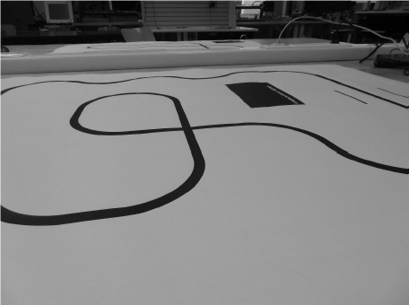

# LineFollower

lege repository die je als template kan gebruiken om een eigen repository te starten voor uw linefollower project

  
## specifications

microcontroller: esp32 CP2102 USB-C 38pin

motors: N20 (600rpm)

h-bridge: DRV8333

sensors: 

batteries: 2x18650 zonder veiligheid

wireless communication: onboard Wifi esp32

distance sensor - motors:

weight:

speed: 

